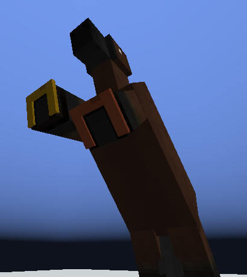
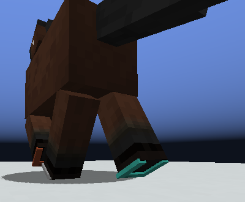
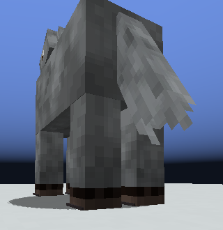
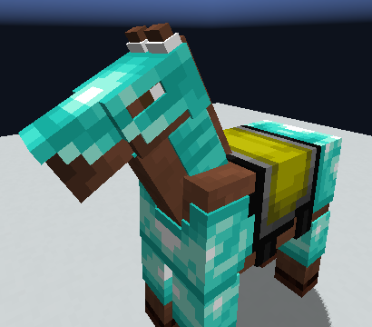
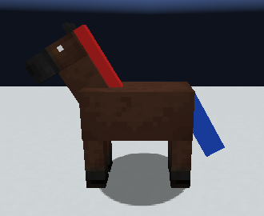

<!--
FOR THE DISCORD BOT. Read this first.
- Written for release 0.5.047.1 ("horse shoes, and gear drawn with depth"). Post the
  messages in order: each one starts at a line reading "MESSAGE n" inside an HTML
  comment. Each is under 2000 characters (Discord's limit).
- Discord cannot show inline markdown images. Upload each file named in an "ATTACH:" line
  with that message (or put it in the embed's image field). The  lines are for
  previewing this file elsewhere; the bot should NOT send them as text.
- Discord markdown only: # ## ### headings, **bold**, *italic*, `code`, > quotes, - lists.
  There are no tables, so none are used here.
- Images live beside this file. All six are real in-game screenshots from the dev client,
  cropped to the horse. None is a diagram.
- Release and download: https://github.com/9-7-8/Procedural-Horse-Coats/releases/tag/v0.5.047.1
-->

<!-- MESSAGE 1 -->
ATTACH: shoes-under-the-feet.png

# 🐴 0.5.047.1: horse shoes
**Horse shoes, and gear drawn with depth.** The first part of the equipment release.

Your horse can now wear **horse shoes**: one on each hoof, each in its own metal.

> ⚠️ **Update the server and every client together.** A 0.5.047.1 client cannot join a 0.5.046 server, or the other way round.

*(Pictured: a golden shoe and a copper shoe under a rearing horse's front feet.)*

<!-- MESSAGE 2 -->
ATTACH: shoes-at-a-walk.png
ATTACH: shoe-edge-standing.png

## Getting and wearing them
- **Five metals:** copper, iron, golden, diamond, netherite. A metal another mod adds gets its own shoe.
- **Bought from the equestrian metalsmith**, one metal a level: 2, 3, 5, 7 and 10 emeralds. No crafting yet.
- Put one in a **hoof slot** in the Gear tab, or right-click your horse with it.
- Four hooves, four shoes. Mix metals if you like. Foals are not shod.

## What a shoe does
- **A little speed and jump** from its own metal, added up over the four hooves. Four netherite shoes are about +1 m/s. Breeding still decides how fast a horse is.
- **One shoe keeps a horse on top of powder snow.** An unshod horse sinks.

<!-- MESSAGE 3 -->
## Two enchantments
The mod's first. They go on horse shoes and nothing else, three levels each.

- **Grip:** the horse slides less on ice. Four shoes of Grip III make ice very nearly ordinary ground.
- **Roadster:** the horse is faster on paths and roads (dirt paths, cobblestone, stone bricks, bricks, smooth sandstone). Four shoes of Roadster III add about 1 m/s.
- One shoe takes **one** of the two. A horse can wear both on different feet.
- Get them at the **enchanting table**, or put a book on a shoe at an **anvil**.

<!-- MESSAGE 4 -->
ATTACH: edged-diamond-armour.png
ATTACH: lifted-braid.png

## Gear drawn with depth
**Horse armour** and the **rescuing braid** now stand a little off the coat, with a real edge. It is a small change, clearest up close. Nothing about the gear itself changed.

Prefer the old flat look? Set `gear.edges` to `false` in `client.toml`.

<!-- MESSAGE 5 -->
## Fixes
- A horse that shifted into a **strider** died in rain or water. A horse no longer shifts into a body that water hurts.
- A shifted horse could **outlive its animal form** at 1 health. It now dies with its form.
- The **arcane dealer** sold lycan horses far too often. Each magical gene now gets an even share.

## Heads up
- Nothing in this release has been played by a person yet, only tested. Tell us what breaks.
- A horse whose animal form is the strider **no longer shifts**. It keeps its genes.
- No world needs converting.

**Download:** https://github.com/9-7-8/Procedural-Horse-Coats/releases/tag/v0.5.047.1
