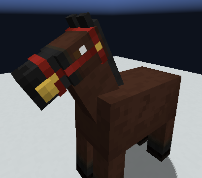
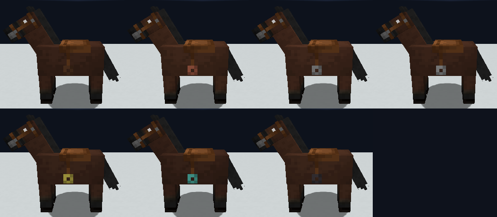
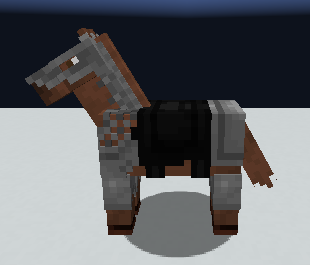
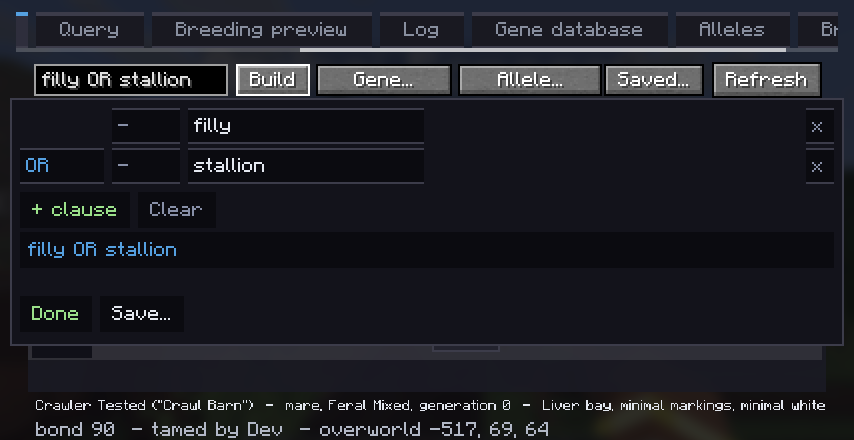

<!--
FOR THE DISCORD BOT. Read this first.
- Written for release 0.5.047.2 ("the bridle and the saddle, and breeding switches for servers"). Post the messages in order:
  each one starts at a line reading "MESSAGE n" inside an HTML comment. Each is under
  2000 characters (Discord's limit).
- Discord cannot show inline markdown images. Upload each file named in an "ATTACH:" line
  with that message (or put it in the embed's image field). The  lines are for
  previewing this file elsewhere; the bot should NOT send them as text.
- Discord markdown only: # ## ### headings, **bold**, *italic*, `code`, > quotes, - lists.
  No tables.
- Images live beside this file. All five are real in-game screenshots from the dev client,
  cropped to the horse. None is a diagram.
- Release and download: https://github.com/9-7-8/Procedural-Horse-Coats/releases/tag/v0.5.047.2
-->

<!-- MESSAGE 1 -->
ATTACH: bridle-dyed.png

# 🐴 0.5.047.2: the bridle and the saddle, and breeding switches for servers
The second part of the equipment release: **riding tack**.

On a horse, vanilla's saddle is now the **Bridle**. It goes on the head, and it is what steers. The **saddle** is a new piece on the back that makes the ride better.

> ⚠️ **Server owners:** natural breeding is now **off by default**. Set `fertility.natural_breeding = true` in `server.toml` to turn it back on. Update the server and every client together.

Horses you already saddled have the saddle moved to the head, and ride as before.

*(Pictured: a bridle dyed at the Tack Dyeing Bench.)*

<!-- MESSAGE 2 -->
ATTACH: saddles.png

## 🪑 Saddles
While you ride, a saddle adds a share of the horse's own speed and jump:
- **Leather** +2.5%, **copper** +4%, **chainmail** +5%, **iron** +6%
- **Golden** +7%, **diamond** +8.5%, **netherite** +10%

Every saddle starts as leather: 3 leather and a horse hair. Add two ingots or gems of a metal to make that metal's saddle. Netherite is made from a diamond saddle. The equestrian leatherworker sells most of them. Other mods' metals get saddles too, if the mod makes a chestplate of them.

A saddle with **no bridle** makes you a passenger until the horse fully trusts you. It walks where it likes.

*(Pictured, top row: leather, copper, chainmail, iron. Bottom row: golden, diamond, netherite.)*

<!-- MESSAGE 3 -->
ATTACH: chainmail-horse-armour.png

## 🛡️ Chainmail horse armour
**Chainmail horse armour** is new: 6 iron chains and a horse hair. Horse armour now comes in every material a chestplate does. Another mod's horse armour protects as well as that mod's own chestplate.

## ⚙️ For servers
- **Breeding switches.** Turn any kind of breeding on or off, even while the server runs: `/horsebreeding`
- **`/horsebank`** files your loose horses into your stasis bank in one go
- **Stasis banks** have no size limit any more
- New operator commands: `/horserealm send` and `/horsesweep`

<!-- MESSAGE 4 -->
ATTACH: build-query-popup.png

## 🔎 Build a search
Every filter box now has a **Build** button: the horse browser, the breeding preview, the stasis bank and the cowboy's counter. Pick what you want row by row and it writes the search for you. You can now search by sex too.

Plus about a dozen screen fixes for small windows, and text that no longer shrinks to unreadable: it ends in "..." with the full text in a tooltip.

**Download:** https://github.com/9-7-8/Procedural-Horse-Coats/releases/tag/v0.5.047.2
